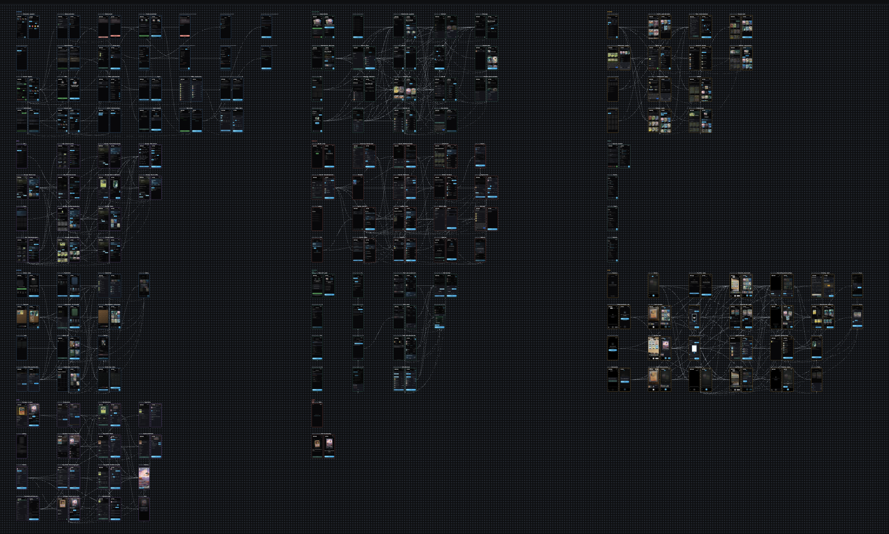
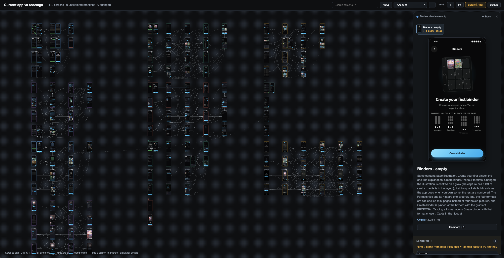

# Flow Map

A map of all the screens of an app, built from real captures, that you can walk through, arrange and comment on. From the same map you ask Claude Code for changes.





*The second screenshot is from an earlier version: the bar and the right-hand panel no longer look like this.*

## What it does

- Opens any map folder and reloads by itself when the folder changes.
- Remembers how you arranged the screens on the canvas and the groups you made.
- Lets you comment on a screen or on an area of it, compare a capture with the previous one and see its history.
- Exports the route between two screens as a video.
- Sends requests to Claude Code: change the map, lay out a new screen or recapture one that changed.

## How it works

It is two pieces that share only a folder on disk.

The `/flow-map` skill (in `skill/`) is what Claude Code uses to create and update that folder: `map.json`, the captures and the connections between screens. Claude walks through the app with Playwright or `agent-device` and registers each screen.

The app (in `src/`) opens the folder in the browser. It captures nothing by itself: when you ask for something from the map, it hands the request to your Claude Code session or launches a separate `claude`, and you approve from the interface any permission it needs.

## Install

Needs macOS, Node 24 and Python 3.

```
git clone https://github.com/jamescardona11/flow-map.git flow-map && cd flow-map && npm install
./install          # asks where to put the skill and the command
./install --yes    # no questions: skill in ~/.claude/skills, command in ~/.local/bin
```

When it finishes, the installer lists the tools it cannot find and how to get them. `./install --tools` installs the two that come from npm: `playwright-cli` to capture web apps and `agent-device` to capture mobile apps. `ffmpeg` (for video) and `claude` are optional.

Other options:

```
./install --symlink --skill-dir ~/.claude/skills --bin-dir ~/.local/bin     # link the skill instead of copying it
./install --app                                                             # create Flow Map.app in ~/Applications
./install --uninstall --skill-dir ~/.claude/skills --bin-dir ~/.local/bin
```

The command stores the path of `node` and of this repo. If you move the repo or change Node, run `./install` again.

If an agent is doing the install, [`INSTALL.md`](INSTALL.md) has the complete steps.

## Usage

Ask Claude Code for a map ("make me the flow map of the login") and the skill creates the folder. Then:

```
flow-map open <folder>    # open the map in the browser
flow-map app <folder>     # open it in its own window (needs Chrome, Edge, Brave or similar)
flow-map                  # open the app with the recent maps
flow-map link <folder>    # link the map to the Claude Code session you run this from
```

With the map linked, what you type in the app's dock reaches that session. Without a session, the "Run with a new Claude" button does the work with a separate `claude`.

## Limitations

- macOS only. The folder picker, the thumbnails and the app window depend on it, and it has not been tested on Linux or Windows.
- When another process changes the map and the page reloads, you lose the selection and the compare mode. Text you were typing is kept.
- A route video takes 30 screens at most and has no subtitles.

## Development

Node 24 runs TypeScript directly, so there is no build step.

```
npm test             # app tests
npm run typecheck
npm start            # the app on port 9999; PORT=<n> uses another
python3 -m unittest discover -s skill/tests    # skill tests
```

The viewer has no automated tests. `tools/viewer-check.ts` tests it in a real browser against a fake `claude`: `PLAYWRIGHT_CORE=<path to playwright-core> node tools/viewer-check.ts`.

## More documentation

- [`ai_docs/reference.md`](ai_docs/reference.md): HTTP routes, files the app writes, limits and errors.
- [`skill/references/schema.md`](skill/references/schema.md): the format of a map folder and the skill's commands.
- [`ai_docs/GLOSSARY.md`](ai_docs/GLOSSARY.md): the project's vocabulary.
